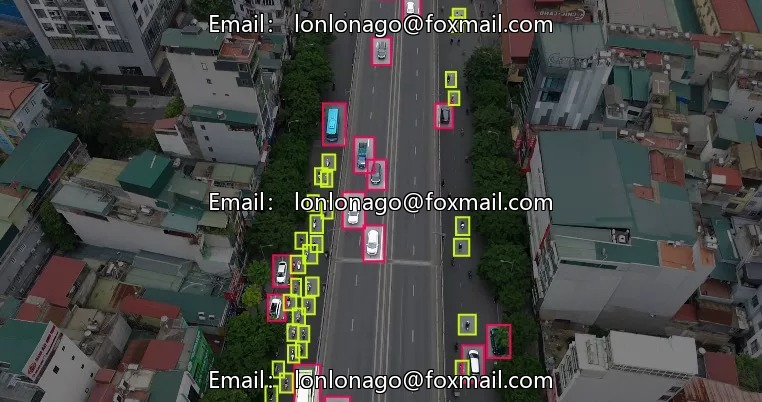
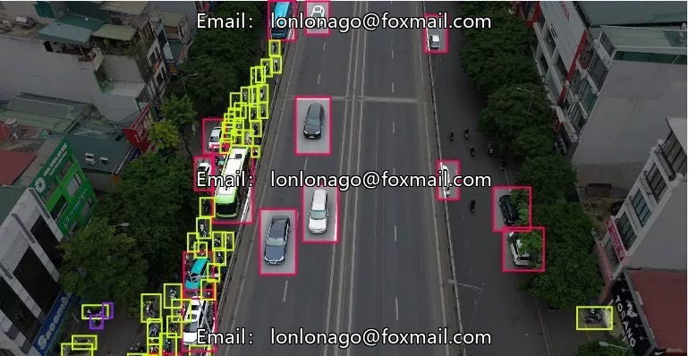
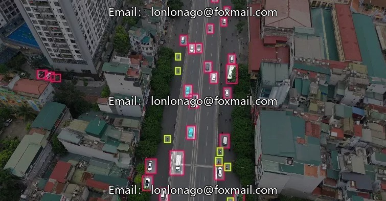
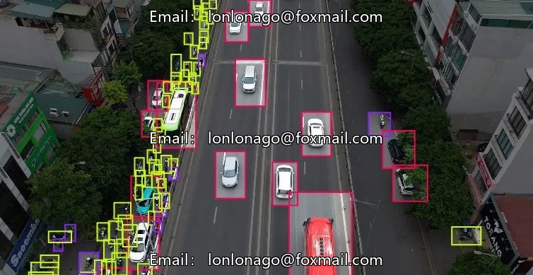
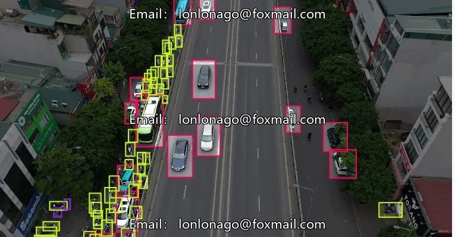

# DJI UAV Aerial Photography Highway Vehicle Pedestrian Small Object Image Dataset, DJI Object Detection Data

## Body

DJI Drone Aerial Photography Road Vehicle and Pedestrian Small Object Image Dataset, Dji Object Detection Dataset Detailed Explanation
Contains 2041 images at the 2K level, focusing on traffic scenes and pedestrian detection, suitable for training tasks in object detection.
The labeling system is clear, comprising three core categories: car (automobile), motorcycle (motorcycle), person (pedestrian).
The dataset does not disclose the split of training and test sets; refer to similar datasets for reference. The training set consists of approximately 1400-1600 images, validation set 200-300 images, and test set 200-300 images.
Each subdataset may have scene differences, following a training-test split internally.
The data format is image files, supporting model training, testing, and performance verification.
This is virtual material, and once sold, there will be .

Interested friends, click "I want".

## Images

## Payment

Here is a pay link on Stripe ( https://buy.stripe.com/3cs8yP7sY87d0vu9AB ). Please contact me lonlonago@foxmail.com after funding $89, and I will send you a complete data files , thank you!

